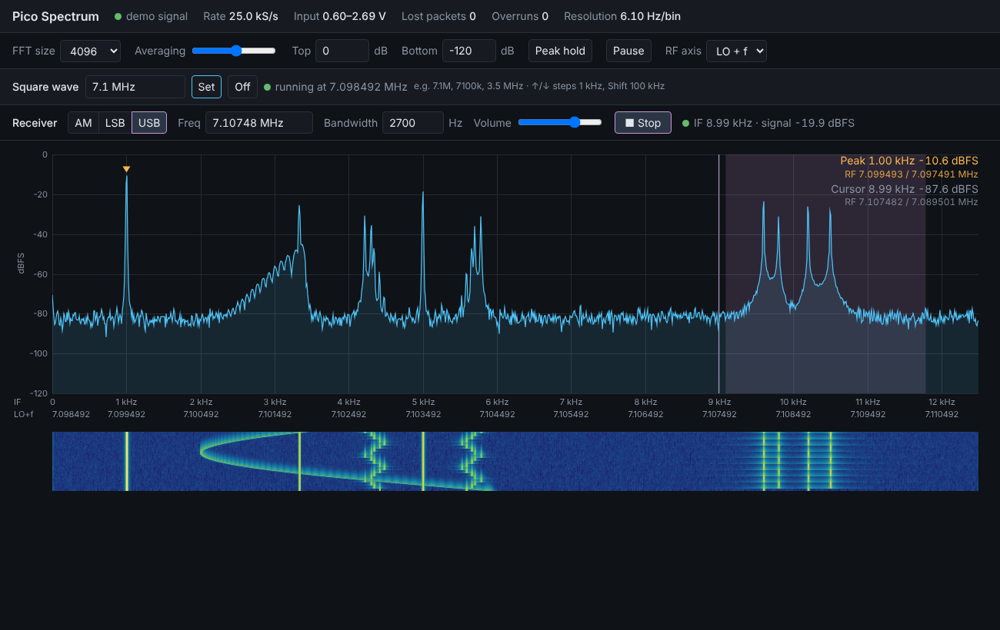

# backend-go

A Go version of `../backend` (the Python spectrum service) plus a receiver:
AM, LSB and USB demodulation with the audio played in the browser.

It does everything the Python backend does, with the same command line
options and the same web page protocol:

- receives the Pico's UDP sample stream and asks the Pico to stream to it
- serves the live spectrum page (spectrum, waterfall, FFT size, averaging,
  peak hold, RF axis) and pushes spectra over a WebSocket
- keeps the Pico's square wave, which is the receiver's LO, at the
  requested frequency (7.1 MHz at startup), re-sending it after a replug

New:

- a **Receiver** bar on the page: mode (AM / LSB / USB), tuning frequency,
  bandwidth, volume and Listen / Stop
- one demodulator per listener on the server, with audio streamed to the
  page over a second WebSocket and played with the Web Audio API
- a Dockerfile that builds a 3.5 MB image, and docker-compose files

The web page is compiled into the binary, so the binary (or the image) is
all you need to run.



## Running

With Go 1.24 or later:

```sh
cd backend-go
go run .                 # with the Pico plugged in
go run . --demo          # test signal, no Pico needed
```

Open <http://localhost:8080>. Or build a binary with `go build` and run
`./pico-websdr`.

It listens on UDP 7778 like the Python backend and `host/receive.py`, so run
only one of them at a time.

Options (same as the Python backend, plus `--static`):

| Option | Default | Meaning |
|---|---|---|
| `--http-port` | 8080 | web page port |
| `--host` | 0.0.0.0 | address to serve on; 127.0.0.1 for this machine only |
| `--device` | 192.168.7.1 | Pico's IP address |
| `--udp-port` | 7778 | UDP port the samples arrive on |
| `--control-port` | 7777 | Pico's stream control port |
| `--freq-port` | 7779 | Pico's square wave TCP port |
| `--freq` | 7.1M | LO at startup: `7.1M`, `3.5M`, `off`, or `keep` |
| `--fps` | 10 | spectrum updates per second |
| `--demo` | off | generate a test signal instead of using the Pico |
| `--static` | built in | serve the page from a folder, for editing `static/index.html` without rebuilding |

Every option can also be given as an environment variable `PICO_<NAME>`, for
example `PICO_DEVICE=192.168.7.1` or `PICO_DEMO=true`. A flag wins over the
variable.

## Listening

1. Pick **AM**, **LSB** or **USB**.
2. Type the frequency in the **Freq** box (`7.074M`, `7074k`, ...) and press
   Enter, or click on the spectrum. ↑/↓ step 100 Hz, Shift+↑/↓ 1 kHz.
3. Press **Listen**. The browser only allows sound after a click, so this
   button is needed once per page load.

The shaded band on the spectrum is what the receiver passes, and the solid
line is the carrier. The status next to Listen shows the IF frequency and
the signal level in the passband.

**Frequency.** While the square wave (LO) runs, the frequency is an RF
frequency, and the receiver covers LO ± 12.5 kHz. Clicking the spectrum
tunes to the RF frequency on the side chosen with **RF axis** (LO + f when
hidden). With the LO off, the frequency is the IF frequency itself (0 to
12.5 kHz). A value below 12.5 kHz is also taken as an IF frequency when the
LO is on.

The mixer folds both sides of the LO onto the same IF: signals at LO + f and
LO − f are heard together, and the receiver cannot separate them. Below the
LO the IF spectrum is mirrored, so an USB signal there is an LSB signal in
the IF. The backend swaps the sideband for you, and the status says "below
LO, sidebands mirrored" when it does.

**Bandwidth.** AM takes the bandwidth centred on the carrier (default
6 kHz, so audio up to 3 kHz, maximum 11.2 kHz). SSB passes from 100 Hz to
100 Hz + bandwidth away from the carrier, on the chosen side (default
2.7 kHz, maximum 5.5 kHz). The page keeps the last mode, frequency and
bandwidths in the browser.

`--demo` contains test signals for this: an AM station on IF 5 kHz
(playing a short tune), an USB signal with its carrier at IF 9 kHz and an
LSB signal with its carrier at IF 11 kHz (both beeping two tones).

## How the receiver works

```
IF samples, 25 kS/s, real
  -> DC block
  -> complex mix with the tuning frequency: carrier to 0 Hz
  -> complex FIR channel filter (343 taps, Blackman), decimate by 2
       AM:  -bw/2 .. +bw/2
       USB: +100 Hz .. +100 Hz + bw
       LSB: -100 Hz - bw .. -100 Hz
  -> AM: envelope |y| minus its average      SSB: real part of y
  -> AGC (2 ms attack, 0.6 s release, at most 70 dB gain)
  -> 16-bit PCM at 12.5 kHz -> WebSocket -> browser
```

The SSB filter is a low-pass shifted to one side of the carrier, so the
other sideband is cut by the filter's stopband (about 75 dB in the
tests), the "filter method" in software. The audio rate is the input rate
divided by a whole number, at most 16 kHz (25 kS/s gives 12.5 kHz).

In the browser the audio is resampled to the sound card's rate and played
with about 150 ms of buffering. Each open page with Listen on gets its own
demodulator, so several people can listen to different signals.

## Docker

```sh
cd backend-go
docker compose up -d --build      # Linux
```

Then open <http://localhost:8080>. `docker compose logs -f` shows the log.

The Dockerfile is multi-stage: the first stage uses the Go toolchain image
to run the tests and compile a static binary, the second copies only that
binary into a distroless base image (about 3.5 MB, runs as a non-root user).
For a quick try anywhere: `docker run --rm -p 8080:8080 pico-websdr --demo`.

### Reaching the Pico from the container

The Pico is a USB network adapter on the host (host 192.168.7.2, Pico
192.168.7.1). The container has to send to it on UDP 7777 and TCP 7779, and
receive its stream on UDP 7778.

**`docker-compose.yml` uses `network_mode: host` (Linux).** The container
shares the host's network stack, so it sees the USB interface exactly like a
program on the host would, including after replugging the Pico. Nothing is
published and the page is on the host's port 8080. This is the simplest and
the most robust choice on a Linux host such as a Raspberry Pi.

**`docker-compose.bridge.yml` uses a normal bridge network**, for Docker
Desktop on macOS or Windows (where host mode does not reach the Mac's USB
interface) or if you prefer not to use host mode:

```sh
docker compose -f docker-compose.bridge.yml up -d --build
```

This works through the host's NAT. The connection to TCP 7779 is an ordinary
outgoing connection. For the stream, the backend sends a datagram to the
Pico's port 7777, and the Pico streams back from port 7777 to whatever
address the datagram came from (the host's 192.168.7.2 after NAT), so the
NAT treats the stream as the reply and forwards it into the container. Port
7778/udp is also published, for the Pico's default destination before it
hears from the backend. Both variants were tested against a simulated Pico
behind a separate network interface, including the Pico appearing only
after the container had started.

On Docker Desktop for Mac, the host must have the Pico's interface up
(`ping 192.168.7.1` from macOS) before the container can reach it. If the
page says "no data from Pico" while macOS can ping it, run the binary
directly on the Mac instead (`go run .`), which needs no Docker networking
at all.

## Protocol

`/ws` is unchanged from the Python backend (status JSON, binary float32
spectra, commands `fft_size`, `averaging`, `squarewave`), so the old page
works against this server and the new page works against the old server
(without the receiver). Status messages gain `"audio": true`.

`/ws/audio`, one demodulator per connection:

| Direction | Message |
|---|---|
| page → server, text | `{"mode": "usb", "freq": 7074000, "bandwidth": 2700}`; mode `off`, `am`, `lsb` or `usb`; any field may be left out |
| server → page, text | `{"type": "demod", "mode", "freq", "bandwidth", "bandwidth_min", "bandwidth_max", "if_freq", "if_low", "if_high", "inverted", "via_rf", "lo", "audio_rate", "signal_db", "error"}`, after each change and twice a second |
| server → page, binary | uint32 LE audio sample rate, then int16 LE mono samples (one message per 20 ms datagram) |

## Files

```
main.go          options, startup
samples.go       datagram parsing, ring buffer, stream statistics
udp.go           UDP receiver, stream subscription, demo signal
squarewave.go    LO control over TCP 7779
spectrum.go      FFT and spectrum averaging
demod.go         AM / SSB demodulator
web.go           HTTP, /ws (spectrum) and /ws/audio (receiver)
demod_test.go    tests: sideband rejection, AM, tuning, FFT, parsing
static/index.html  the web page (embedded in the binary)
Dockerfile, docker-compose.yml, docker-compose.bridge.yml
```

`go test ./...` runs the tests, the Docker build runs them too.
