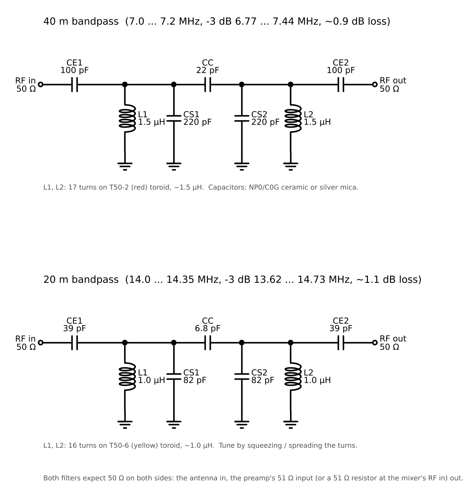
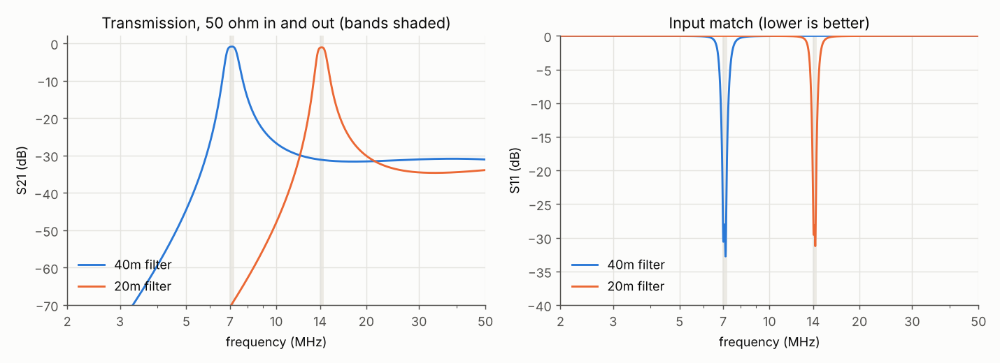
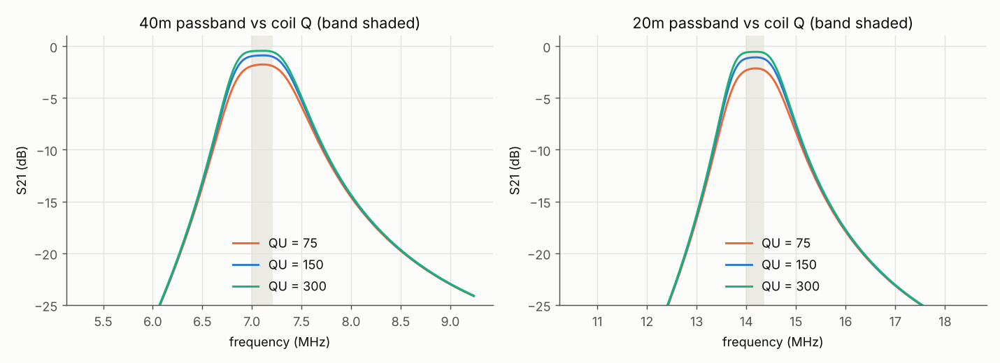
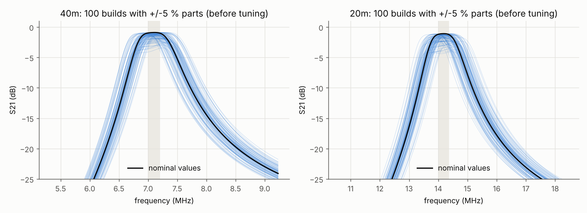

# Bandpass filters for 40 m and 20 m (optional)

These are two simple, fixed bandpass filters that go between the antenna and
the RF preamp (or the mixer). They are optional: the receiver works without
them, but a filter helps in two ways:

* Strong signals outside the band (broadcast stations, other ham bands) no
  longer reach the BF961 stages, where they could overload them.
* The LO from GP8 is a square wave, so the mixer also responds at 3 × f_LO.
  Without a filter, a signal at 21.3 MHz would show up on the same IF as one
  at 7.1 MHz. The filter attenuates that image by about 31 dB on 40 m and
  34 dB on 20 m.



`schematic.png` is generated by `sim/draw_schematic.py` (schemdraw).

## How the filter works

Each filter has two parallel LC tanks (L1/CS1 and L2/CS2), both tuned to
the middle of the band. At resonance a tank has a very high impedance, so
the signal passes. Away from resonance the coil (below the band) or the
capacitor (above it) shorts the signal to ground.

* **CC** couples the two tanks. Its value sets how much they interact, and
  that gives the flat top of a 2-pole Butterworth response.
* **CE1 and CE2** match the 50 Ω antenna and load to the tanks' much higher
  impedance (about 1.1 kΩ on 40 m and 1.8 kΩ on 20 m). Without them the
  50 Ω would load the tanks so heavily that they would hardly filter at all.

The values come from the standard coupled-resonator method (Zverev,
*Handbook of Filter Synthesis*; Hayward et al., *Experimental Methods in RF
Design*, ch. 3). Each `.inc` file shows the full calculation in its header.

## Parts

| | 40 m (7.0 to 7.2 MHz) | 20 m (14.0 to 14.35 MHz) |
|---|---|---|
| CE1, CE2 | 100 pF | 39 pF |
| CC | 22 pF | 6.8 pF |
| CS1, CS2 | 220 pF | 82 pF |
| L1, L2 | 1.5 µH: 17 to 18 turns on a T50-2 (red) toroid | 1.0 µH: 16 turns on a T50-6 (yellow) toroid |

* Use NP0/C0G ceramic or silver-mica capacitors. X7R and other high-k
  ceramics drift with temperature and voltage.
* Wind the toroids with about 0.4 to 0.5 mm enamelled wire, spread evenly
  around the core.
* The 20 m filter is designed 1 MHz wide for a 350 kHz band, so part
  tolerances don't push a band edge out of the passband.

## Simulated performance

Simulated between 50 Ω source and load, with a coil Q of 150 (typical for T50
cores at HF). The full numbers are in `plots/results.txt`.

| | 40 m | 20 m |
|---|---|---|
| Loss in the band centre | 0.9 dB | 1.1 dB |
| Loss at the band edges | 1.0 dB | 1.2 dB |
| -3 dB bandwidth | 6.77 to 7.44 MHz | 13.62 to 14.73 MHz |
| Input match (S11) in the band | better than -19 dB | better than -18 dB |
| Rejection of the other band | 31 dB at 14.2 MHz | 70 dB at 7.1 MHz |
| Rejection at 3 × f_LO | 31 dB at 21.3 MHz | 34 dB at 42.5 MHz |



The coil Q matters only a little. With Q = 75 the loss roughly doubles (to
about 1.8 dB on 40 m and 2.2 dB on 20 m), and the passband keeps its shape:



The tolerance check builds 100 virtual copies, each with every L and C off
by a random amount within ±5 %. Before any tuning, 88 % of the 40 m builds
and 76 % of the 20 m builds lose less than 3 dB at both band edges. The
worst case is 4.1 dB on 40 m and 5.3 dB on 20 m, because the centre
frequency moves by up to about ±4 %.



### Tuning

With a signal generator or a noise source and the SDR itself, peak the
response in the middle of the band. Squeeze a coil's turns together to lower
its resonance, or spread them apart to raise it, and tune each coil in turn.
Without test gear, the filters still work untuned in most builds.

## How it connects

```
antenna ──► bandpass filter ──► RF preamp (51 Ω input) ──► mixer RF in
```

The filter needs 50 Ω on both sides. The preamp's 51 Ω input termination
provides that on the output side. **If you leave the preamp out**, solder a
51 Ω resistor from the mixer's RF in to GND, because the mixer's own input is
100 kΩ and would leave the filter unterminated. See `../rf_preamp/chain.png`
and the chain simulation in `../rf_preamp/README.md`.

To switch bands, swap the filter or switch between the two filters with a
2-pole switch (or two relays) at the input and the output.

## Running the simulation

This needs ngspice and Python 3 with numpy and matplotlib. The schematic
script also needs schemdraw.

```
cd bandpass
python3 sim/run.py              # all runs, a few seconds; writes plots/ and plots/results.txt
python3 sim/draw_schematic.py   # redraws schematic.png
cd sim && ngspice bpf.cir       # quick interactive run with a plot window
```

| File | Contents |
|---|---|
| `sim/bpf_40m.inc`, `sim/bpf_20m.inc` | filter subcircuits `BPF40M` / `BPF20M` (pins: in, out), design notes in the header |
| `sim/bpf.cir` | stand-alone ngspice deck, both filters, one AC sweep |
| `sim/run.py` | nominal response, coil Q, tolerance check, plots |
| `sim/draw_schematic.py` | draws `schematic.png` |
| `plots/` | results from the last run |
