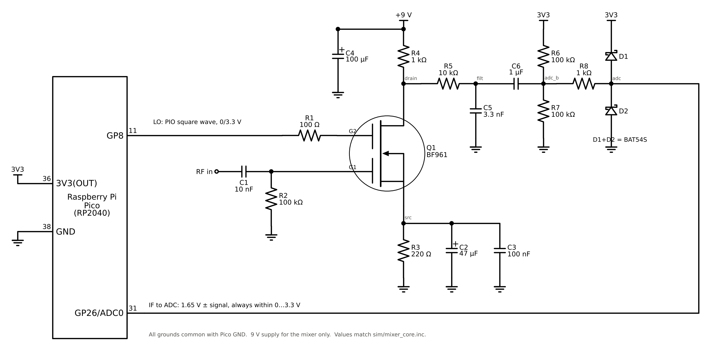
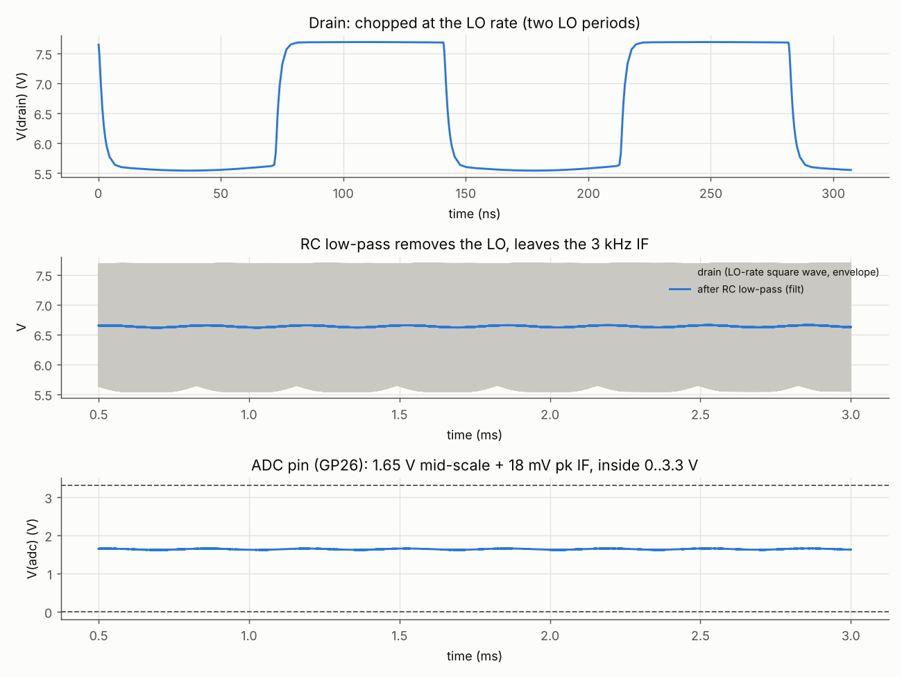
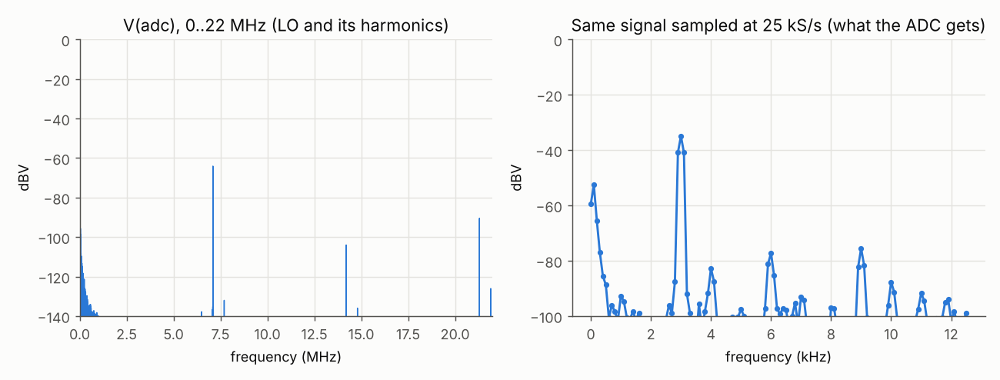
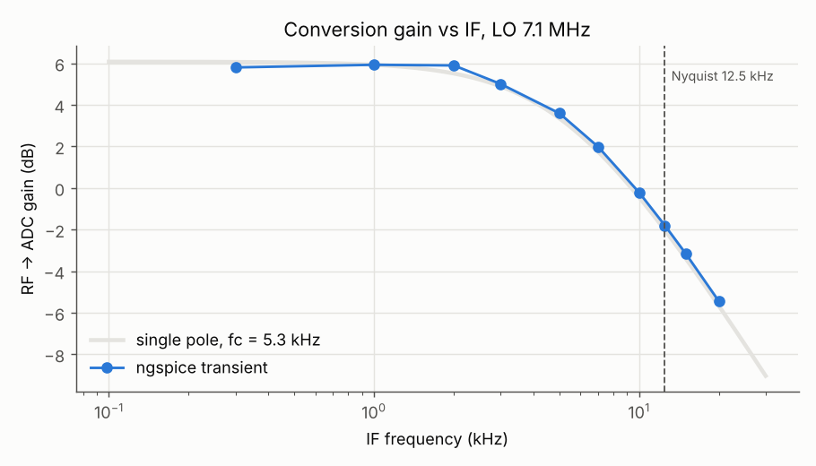
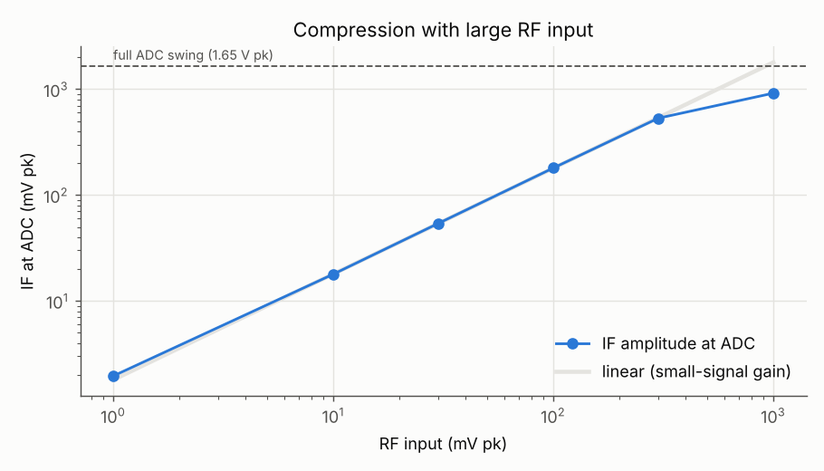
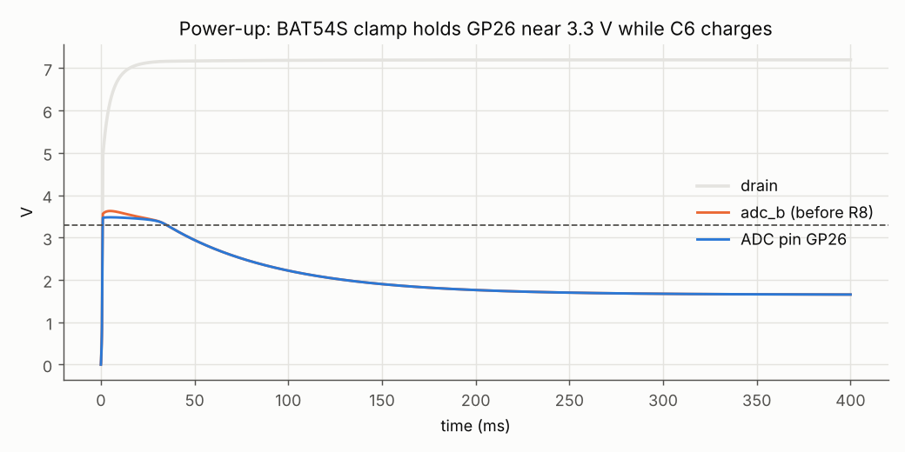
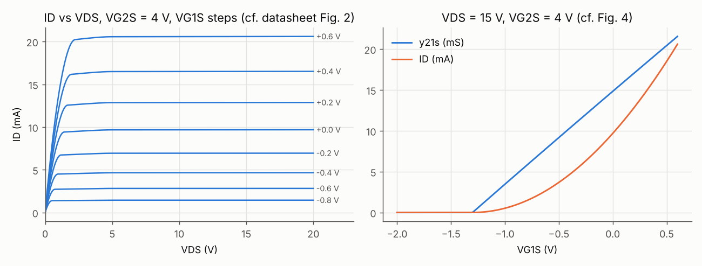

# BF961 mixer front end for the RP2040 webSDR

A very simple direct-conversion mixer. The RP2040's PIO square wave (GP8) is the
local oscillator, a BF961 dual-gate MOSFET does the mixing, a single-pole RC
low-pass cleans up the output, and the result goes to the ADC input GP26.
There is no RF input filter in this version.



The drawing above is `schematic.png`, generated by `sim/draw_schematic.py` (schemdraw). The text version below shows the same circuit.

```
                          +9 V ────┬──── C4 100u ── GND
                                   │
                                  R4 1k
                                   │          R5 10k             C6 1u              R8 1k
                                   ├─ drain ──/\/\/──┬── filt ───┤├───┬── adc_b ───/\/\/───┬───► GP26 (ADC0)
                                   │ D               │                │                    │
 RP2040 GP8 (LO) ──/\/\/───── G2 ──┤               C5 3.3n          R6 100k to 3V3       D1/D2 BAT54S
                   R1 100          │  Q1 BF961       │              R7 100k to GND       clamp to 3V3 / GND
 RF in ──┤├───┬────────────── G1 ──┤                GND
       C1 10n │                    │ S
            R2 100k                ├────────┬─────────┐
              │                    │        │         │
              GND                R3 220   C2 47u   C3 100n
                                   │        │         │
                                  GND      GND       GND
```

How it works: gate 1 takes the RF and sets the transconductance; gate 2 is
switched by the 0/3.3 V LO, so the drain current (and with it the RF gain) is
chopped at the LO rate. That multiplication puts the RF at |f_RF - f_LO| on the
drain. R5/C5 removes the LO and the sum products, C6 blocks the drain's ~6.6 V
DC, and R6/R7 re-bias the signal at 1.65 V, the middle of the ADC range.

## Component values

| Ref | Value | Job |
|---|---|---|
| Q1 | BF961 | dual-gate MOSFET mixer (check the pinout against the datasheet) |
| R1 | 100 Ω | series damping between GP8 and gate 2 (LO is DC-coupled, 0/3.3 V) |
| C1 | 10 nF | RF coupling to gate 1 |
| R2 | 100 kΩ | gate 1 DC return, so VG1S = -V(source) (self bias) |
| R3 | 220 Ω | source self-bias, ~2.35 mA average with the LO running |
| C2, C3 | 47 µF + 100 nF | source bypass: 100 nF for RF, 47 µF so the IF gain stays flat down to ~100 Hz |
| R4 | 1 kΩ | drain load, from +9 V |
| C4 | 100 µF (+100 nF) | 9 V rail decoupling |
| R5, C5 | 10 kΩ, 3.3 nF | **single-pole RC low-pass**, corner ≈ 5.3 kHz (see below) |
| C6 | 1 µF, ≥16 V | DC block; the 9 V side never reaches the ADC. Ceramic X7R or film. If electrolytic, + toward R5 |
| R6, R7 | 100 kΩ, 100 kΩ | bias GP26 at 1.65 V, from the Pico's 3V3(OUT) pin |
| R8 | 1 kΩ | current limit into GP26 |
| D1, D2 | BAT54S | clamps GP26 to 3V3 / GND (power-up and overload protection) |

Ground the mixer to the Pico's GND. The 3V3 for R6 and the clamp comes from the Pico's 3V3(OUT).

### Why a 5.3 kHz RC corner

The firmware samples GP26 at 25 kS/s, so anything above 12.5 kHz at the ADC
folds back into the band. A single pole can't make a real anti-alias filter, so
the corner sits below Nyquist where it still does some good: the useful IF band
is about 0 to 6 kHz (SSB/CW width), and signals that would alias into it
(19 kHz and up) are 10 dB or more down. The effective resistance is
(R4 + R5) ∥ (R6 ∥ R7) = 9 kΩ, so f_c = 1 / (2π · 9 kΩ · 3.3 nF) ≈ 5.3 kHz.
For a wider IF use C5 = 1.5 nF (≈ 12 kHz) at the cost of more aliasing.

## The BF961 model

No vendor SPICE model exists for the BF961, so `models/bf961.lib` is derived
from the datasheet. It is the usual dual-gate equivalent: two cascoded
depletion-mode level-1 NMOS transistors (gate 1 = lower device, gate 2 =
upper device), plus the datasheet's terminal capacitances and the integrated
back-to-back gate protection diodes. VTO and KP of the two devices were fitted
to these datasheet points (VDS = 15 V, VG2S = 4 V):

| Parameter | Datasheet | Model |
|---|---|---|
| IDSS (VG1S = 0) | 4 to 20 mA | 9.7 mA (middle of the range) |
| y21s at ID = 10 mA | 15 mS typ, 12 min | 15.1 mS |
| -VG1S(off) at 20 µA | ≤ 3.5 V | 1.24 V |
| -VG2S(off) at 20 µA | ≤ 3.5 V | 0.96 V |
| Cissg1 / Cissg2 / Crss / Coss | 3.7 pF / 1.6 pF / 25 fF / 1.6 pF | same, as fixed capacitors |
| Gate breakdown | 8 to 14 V | 10 V zener pair per gate |

Limits: it is square-law (gm keeps rising with VG1S instead of flattening as in
datasheet Fig. 4), it has no noise model, and the capacitances don't vary with
bias. That is fine for the DC bias and the kHz-range IF, which is what matters
here. `plots/bf961_model.png` shows the model curves next to the datasheet's
figure numbers for comparison. Real parts spread from 4 to 20 mA IDSS; the
self-bias resistor R3 keeps the operating point reasonably stable across that.

## Simulation results

Run with LO = 7.100 MHz (40 m band), RF tone 7.103 MHz at 10 mV peak, so the
wanted IF is 3 kHz. Full numbers are in `plots/results.txt`.

| Quantity | Simulated |
|---|---|
| Operating point with LO running | V(source) 0.52 V (2.35 mA avg), V(drain) 6.65 V avg |
| Drain swing at the LO rate | about 5.5 V to 7.7 V (LO high / low) |
| Conversion gain, RF in to ADC pin, 3 kHz IF | +5.1 dB (10 mV pk RF gives 17.9 mV pk IF) |
| IF response | flat +5.9 dB from 0.3 to 2 kHz, -3 dB at ~5.5 kHz, -7.7 dB at 12.5 kHz |
| ADC pin DC level | 1.64 V |
| LO feed-through at the ADC pin | about 1 mV pp |
| 1 dB compression | between 0.3 and 1 V pk RF in (still linear at 0.3 V pk) |
| 1 V pk RF in | 0.92 V pk IF, ADC pin stays 0.55 to 2.48 V |
| Power-up peak at GP26 | 3.48 V (clamped), settles to 1.65 V in ~250 ms |








What this means in practice:

* Conversion gain is modest (about +5 to +6 dB), because when GP8 is low gate 2
  sits only ~0.5 V below the source and the BF961 doesn't fully turn off. A
  10 mV RF signal gives about 18 mV at the ADC, i.e. ~22 ADC counts peak.
  Antenna-level signals (µV) will need an RF preamp in front, or more IF gain.
* The ADC pin never leaves 0 to 3.3 V: at 1 V peak RF in the IF is ~0.9 V peak
  around 1.65 V, and at power-up (both rails ramped from 0, C6 empty) the BAT54S
  clamp holds GP26 at ≤ 3.48 V, under the RP2040's IOVDD + 0.5 V limit, while
  C6 charges (about 250 ms).
* LO feed-through at the ADC pin is about 1 mV after the RC filter.
* The LO works anywhere the firmware can put it; the simulation used 7.1 MHz.
  Very low LO frequencies (tens of kHz) would put the LO itself close to the
  IF band, where the single RC pole doesn't remove it.

## Optional front end

Two optional stages can go in front of the mixer's RF input:

* `../bandpass/`: fixed 50 Ω bandpass filters for 40 m and 20 m. They keep
  out-of-band signals and the 3 × f_LO response of the square-wave LO away
  from the mixer.
* `../rf_preamp/`: a second BF961 as an RF preamp with about 20 dB of gain,
  set by a potentiometer.

`../rf_preamp/chain.png` shows how they connect. If you use a filter without
the preamp, put 51 Ω from RF in to GND so that the filter sees its 50 Ω load.

## Running the simulation

Needs ngspice (macOS: `brew install ngspice`) and, for the plots, Python 3 with
numpy and matplotlib (`pip3 install numpy matplotlib`).

```
cd mixer
python3 sim/run.py          # all runs, ~4 min; writes plots/*.png and plots/results.txt
```

Or one interactive run with ngspice's own plot windows:

```
cd mixer/sim
ngspice mixer.cir
```

Files:

| File | Contents |
|---|---|
| `models/bf961.lib` | BF961 subcircuit (pins: drain, gate 2, gate 1, source) |
| `sim/mixer_core.inc` | the mixer circuit, node names as in the schematic above |
| `sim/mixer.cir` | stand-alone ngspice deck, one 3 ms run with plots |
| `sim/run.py` | model check, operating point, mixer run, IF sweep, overload and power-up runs, plots |
| `plots/` | results from the last run |
| `schematic.png`, `sim/draw_schematic.py` | schematic with the Pico connections; redraw with `python3 sim/draw_schematic.py` (needs `pip3 install schemdraw`) |

`run.py` first settles the operating point with a 100 kHz LO (the average
voltages depend on LO duty cycle, not frequency, and this is much faster to
simulate), then starts each 7.1 MHz run from that point with `.ic`.
