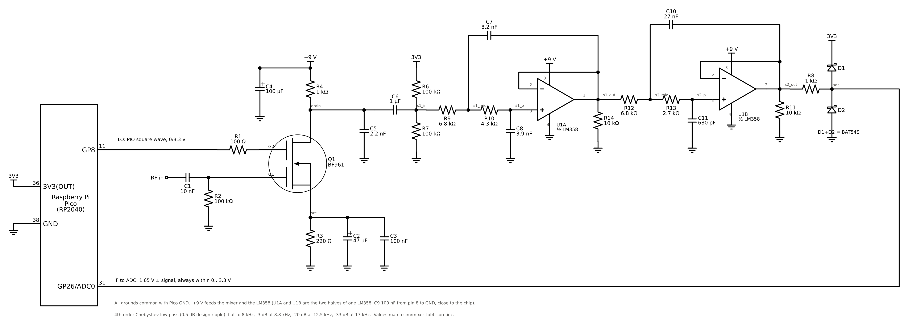
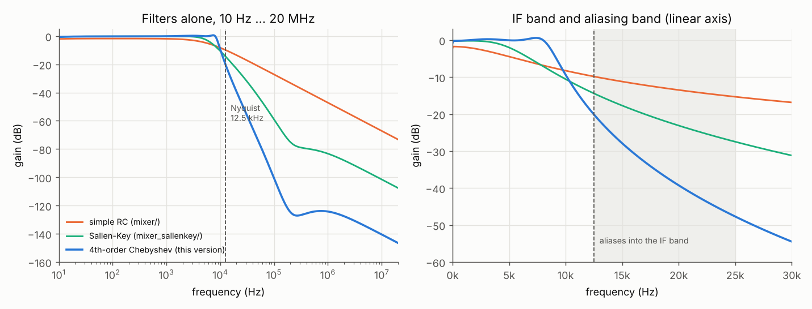
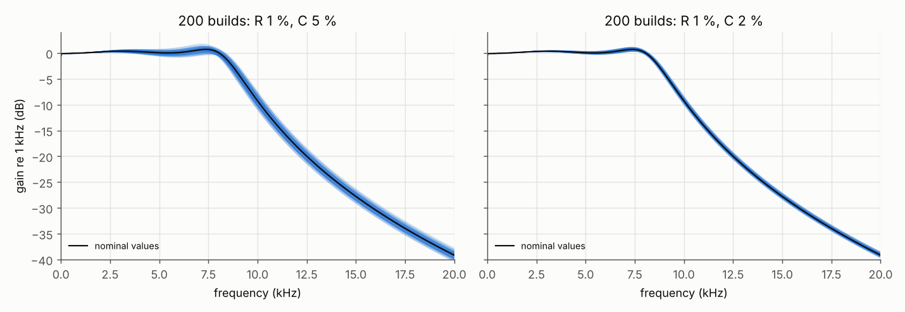
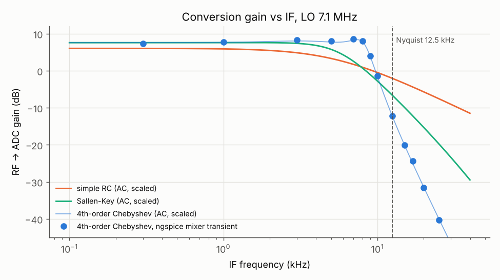
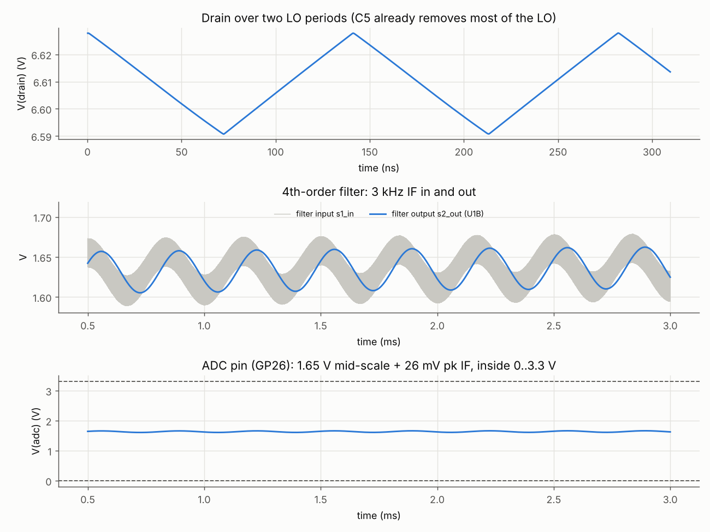
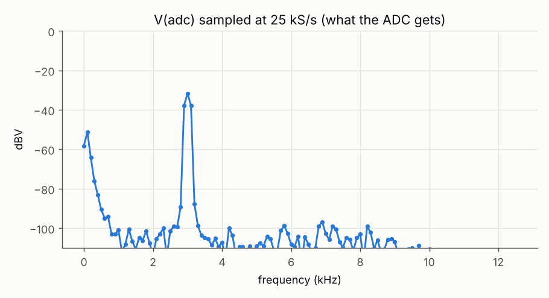
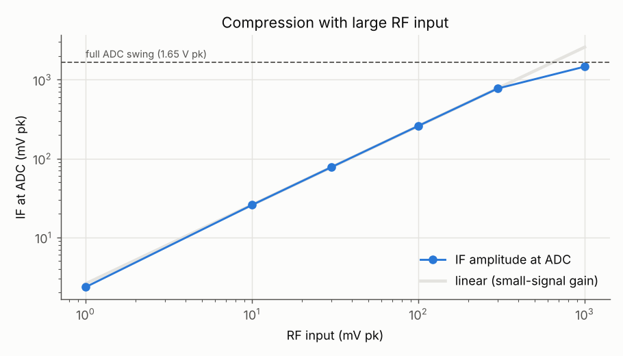
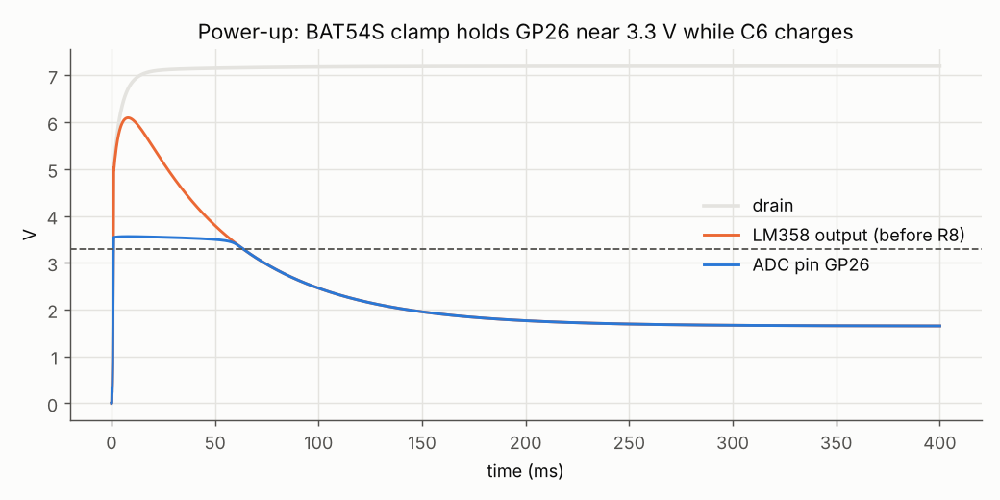

# BF961 mixer with an LM358 4th-order Chebyshev low-pass

This is the third version of the mixer. The two earlier versions stay as they
are:

* `../mixer/`: a simple 1-pole RC filter.
* `../mixer_sallenkey/`: a 2-pole Sallen-Key filter on one half of an LM358.

This version uses **both halves** of the same LM358 to build a **4th-order
Chebyshev** low-pass. The IF stays flat up to **8 kHz**, compared with about
5 kHz before, and the filter is much steeper above that. The BF961 part (LO on GP8,
RF input, self bias, drain load) is unchanged, part for part.



`schematic.png` is generated by `sim/draw_schematic.py` (schemdraw).

## How it compares

These are the filters alone, from the drain to the filter output (ngspice, LM358 model,
values from `plots/results.txt`):

| | **4th-order Chebyshev (this)** | Sallen-Key | Simple RC |
|---|---|---|---|
| op-amps | 2 (one LM358) | 1 (half an LM358) | none |
| gain at 1 kHz | -0.1 dB | -0.2 dB | -1.9 dB |
| gain at 8 kHz | **0.0 dB** | -7.1 dB | -6.8 dB |
| -3 dB frequency | **8.8 kHz** | 5.8 kHz | 5.5 kHz |
| at 12.5 kHz (Nyquist) | -20 dB | -14 dB | -10 dB |
| at 17 kHz (aliases to 8 kHz) | **-33 dB** | -20 dB | -12 dB |
| at 20 kHz (aliases to 5 kHz) | **-39 dB** | -23 dB | -14 dB |
| at 25 kHz (aliases to 0 Hz) | **-48 dB** | -28 dB | -15 dB |
| 7.1 MHz LO | -138 dB | -99 dB | -64 dB |

These are the results with the whole mixer (LO 7.1 MHz, RF 10 mV pk):

| | **This** | Sallen-Key | Simple RC |
|---|---|---|---|
| conversion gain, RF → ADC pin | +8.2 dB | +7.6 dB | +5.1 dB |
| LO ripple at the ADC pin | 0.01 mV pp | 0.02 mV pp | about 1 mV pp |
| power-up peak at GP26 | 3.56 V | 3.56 V | 3.48 V |



### Why the corner can go up to 8 kHz

The ADC samples at 25 kS/s. A signal at f, where f is between 12.5 and 25 kHz,
shows up in the IF band at 25 kHz - f. So aliasing does not depend on what the
filter does at 12.5 kHz. It depends on what the filter does at **25 kHz minus the top of the
IF you use**. If the IF is used up to 8 kHz, the aliases that land in it come
from 17 kHz and above, where this filter is already 33 to 48 dB down.

* The RC and Sallen-Key filters had to keep their corner near 5.7 kHz, and
  even so they only reach 12 dB (RC) or 20 dB (Sallen-Key) at 17 kHz.
* The 4th-order filter falls 24 dB per octave, so it can be flat up to 8 kHz
  and still beat both of them by 13 to 21 dB at the alias frequencies.
* A higher corner lets aliases from closer in reach the IF. With every filter
  capacitor scaled by 0.8, for example, the filter is flat to 10 kHz (-3 dB at 10.9 kHz), but it is
  only 24 dB down at 17 kHz instead of 33 dB, and aliases from 15 kHz now land
  inside the flat part. 8 kHz is a good balance. To move the corner anyway, scale
  **all four** capacitors (C7, C8, C10, C11) by the same factor.

## How it works

1. **C5 (2.2 nF) on the drain: LO roofing.** The LM358 cannot filter MHz
   signals itself because it has no loop gain left there, so C5 forms a 72 kHz
   low-pass with the 1 kΩ drain load R4. That takes the 7 MHz LO down by about
   40 dB before the op-amps. It is smaller than the 4.7 nF in the Sallen-Key
   version so that it stays well away from the higher 8 kHz corner.
2. **C6 + R6/R7: DC block and 1.65 V bias**, the same as before. Both op-amps
   are followers at DC, so the ADC pin sits at 1.65 V.
3. **Two unity-gain Sallen-Key stages.** A 4th-order filter is made from
   two 2nd-order stages, each with its own corner frequency f0 and Q. For a 4th-order Chebyshev
   with 0.5 dB ripple and an 8 kHz passband edge, the textbook values are:

   | Stage | Op-amp | Parts | f0 | Q | Job |
   |---|---|---|---|---|---|
   | 1 | U1A | R9 6.8k (+ R4 1k), R10 4.3k, C7 8.2n, C8 3.9n | 4.8 kHz | 0.71 | gentle, shapes the low passband |
   | 2 | U1B | R12 6.8k, R13 2.7k, C10 27n, C11 680p | 8.25 kHz | 2.94 | peaky, lifts the response near 8 kHz, then makes the steep knee |

   Neither stage alone is flat. Stage 1 starts rolling off at 4.8 kHz,
   and stage 2 has a 9 dB bump at 8 kHz. Together they are flat to within
   about 0.8 dB from 100 Hz to 8 kHz. That is a little more than the
   design's 0.5 dB because of E24 rounding and the LM358's bandwidth.
   A high Q needs a large ratio between the two capacitors of a stage
   (Q ≤ √(C10/C11) / 2), which is why stage 2 uses 27 nF and 680 pF. The
   values were computed from the textbook pole table, rounded to E24/E12,
   then fine-tuned in ngspice with R4, C5, the bias divider and the LM358
   model in place, to match the ideal Chebyshev curve within 0.1 dB rms.
   The comments in `sim/mixer_lpf4_core.inc` show the calculation.
4. **R14, R11 (10 kΩ) to GND** on each op-amp output. Each draws a steady 165 µA, which
   keeps the LM358 output stage out of its crossover region.
5. **R8 + BAT54S: ADC protection**, the same as the earlier versions.

## Parts

Only the parts that differ from `../mixer/` are listed here. R1 to R4, C1 to C4, Q1,
D1/D2 and R8 are unchanged. R5 is no longer used.

| Ref | Value | Job |
|---|---|---|
| C5 | 2.2 nF | LO roofing at the drain |
| C6 | 1 µF | DC block |
| R6, R7 | 100 kΩ | 1.65 V bias from 3V3 |
| R9, R10 | 6.8 kΩ, 4.3 kΩ, 1 % | stage 1 |
| C7, C8 | 8.2 nF, 3.9 nF, C0G/film | stage 1 (C7 from the R9/R10 junction to the U1A output) |
| R12, R13 | 6.8 kΩ, 2.7 kΩ, 1 % | stage 2 |
| C10, C11 | 27 nF, 680 pF, C0G/film | stage 2 (C10 from the R12/R13 junction to the U1B output) |
| U1 | LM358 (DIP-8 or SO-8) | A = stage 1, B = stage 2 |
| R14, R11 | 10 kΩ | output pull-downs |
| C9 | 100 nF | supply decoupling, pin 8 to GND |

LM358 pins: 1 = OUT A, 2 = IN A-, 3 = IN A+, 4 = GND, 5 = IN B+, 6 = IN B-,
7 = OUT B, 8 = V+ (+9 V). 4.3 kΩ is an E24 value. If you only have E12, use 4.7 kΩ
for R10. The simulation then shows -3 dB at 8.7 kHz instead of 8.8 kHz, which hardly
differs.

### Part tolerances

Stage 2's high Q makes it the sensitive part, mostly to the C10/C11 ratio.
`run.py` builds 200 virtual copies with random part values:

| | Variation 0.1 to 8 kHz | Gain at 8 kHz | At 17 kHz |
|---|---|---|---|
| R 1 %, C 5 % | median 0.86 dB, worst 1.9 dB | -0.7 to +0.9 dB | -34 to -31 dB |
| R 1 %, C 2 % | median 0.83 dB, worst 1.3 dB | -0.3 to +0.6 dB | -33 to -32 dB |

Ordinary 5 % C0G or film capacitors are fine. The passband stays within about
2 dB in the worst case, and the alias rejection hardly changes. **Do not use X7R
or Y5V ceramics** in the filter. Their capacitance can change by 10 to 50 %
with voltage and temperature.



## Simulated performance with the mixer



The points are full mixer transients, one per IF. The lines are the AC
response of each filter, shifted to the same gain at 1 kHz.

* **IF band:** within +7.4 to +8.5 dB from 300 Hz to 8 kHz.
* **Aliases:** an RF signal 17 kHz away from the LO reaches the ADC 32 dB below a
  wanted signal, and lands at 8 kHz. One 20 kHz away is 39 dB below and lands at 5 kHz.
* **Overload:** the mixer stays linear up to about 300 mV of RF. At a huge 1 V
  input, the LM358 output reaches its lower limit near 0 V and the peaks reach 3.46 V at the
  pin. The BAT54S just starts to clamp there, well below the RP2040's 3.8 V limit.
* **Power-up:** the same as the Sallen-Key version. The op-amp output rises to 6.1 V while
  C6 charges (about 60 ms), and GP26 is held at 3.56 V.
* **5 V supply:** it also works with both the mixer and the LM358 on 5 V and R3 = 470 Ω.
  The 3 kHz gain is then +6.6 dB (9 V: +8.2 dB).
* **Supply current:** about 3.4 mA. That is 2.35 mA for the BF961, 0.7 mA for the LM358 and
  0.33 mA for R11 and R14.






A Chebyshev filter has a slightly uneven delay near its corner, so a pulse
shows a little ringing. That does not matter for SSB, CW or AM audio.

The LM358 model (`models/lm358.lib`) is the same behavioural model as in
`../mixer_sallenkey/`, built from datasheet typical values: 100 dB gain,
0.7 MHz gain-bandwidth, 0.3 V/µs slew rate, output from 5 mV to Vcc - 1.5 V. It does not model noise or
crossover distortion.

## Running the simulation

This needs ngspice and Python 3 with numpy and matplotlib, plus the sibling folder
`../mixer/` for the shared BF961 model. The schematic script also needs
schemdraw.

```
cd mixer_lpf4
python3 sim/run.py                # all runs, about 8 minutes; writes plots/ and plots/results.txt
python3 sim/draw_schematic.py     # redraws schematic.png
cd sim && ngspice mixer_lpf4.cir  # quick interactive run with plot windows
```

| File | Contents |
|---|---|
| `models/lm358.lib` | LM358 behavioural model (one amplifier) |
| `sim/mixer_lpf4_core.inc` | the circuit, with the filter design worked out in the comments |
| `sim/mixer_lpf4.cir` | stand-alone ngspice deck, one 3 ms run at 3 kHz IF |
| `sim/run.py` | model check, three-way filter comparison, tolerance check, mixer runs, IF sweep, overload, power-up, 5 V |
| `sim/draw_schematic.py` | draws `schematic.png` |
| `plots/` | results from the last run |

The optional bandpass filters (`../bandpass/`) and RF preamp (`../rf_preamp/`)
connect to this version the same way as to the other two: preamp output to RF in.
