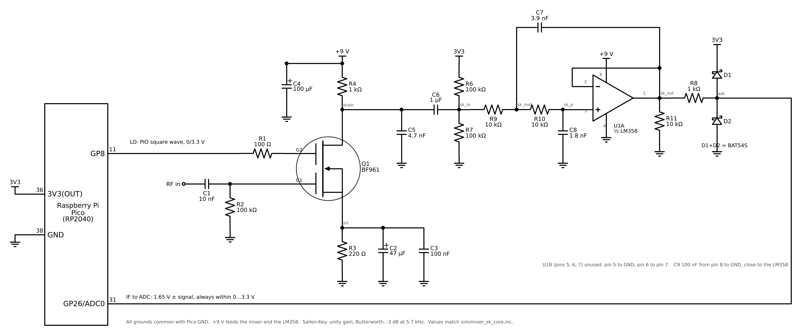
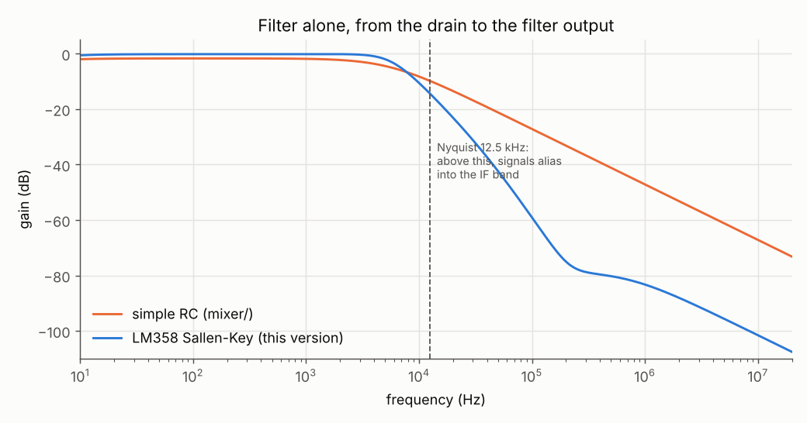
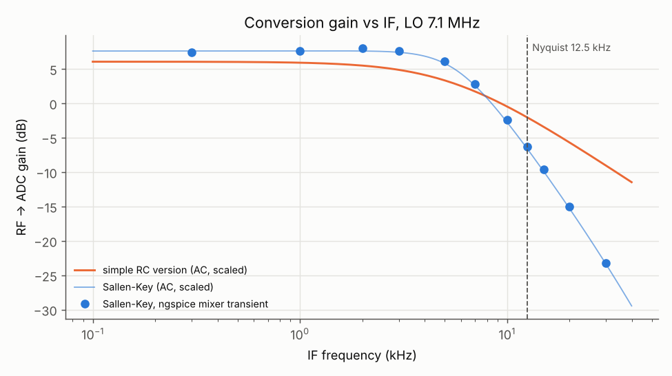
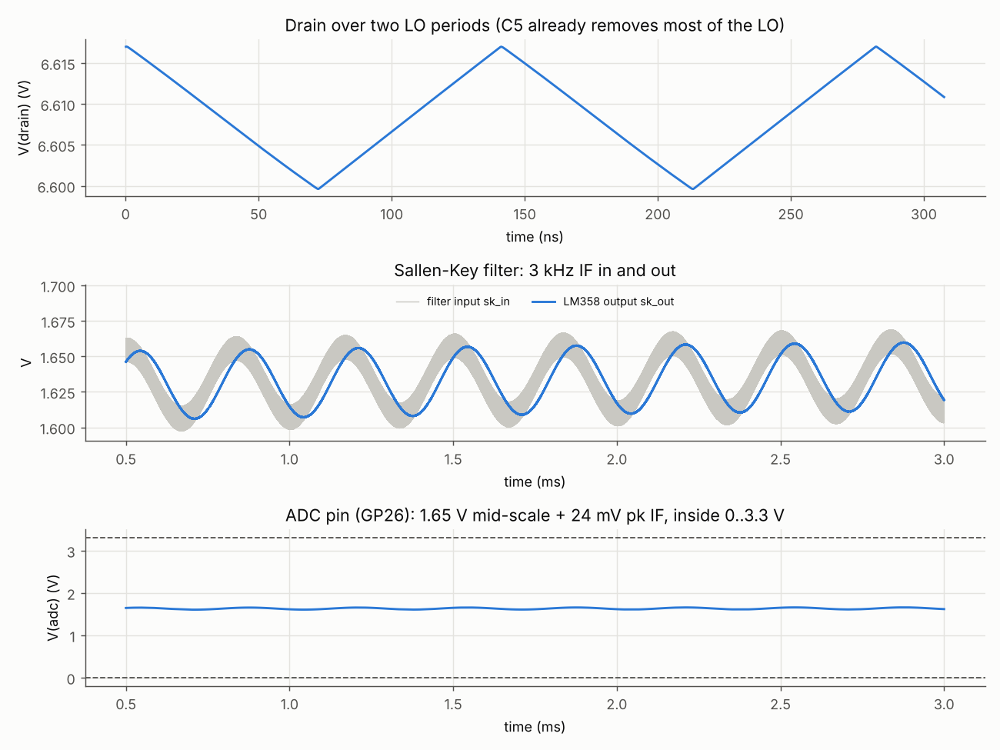
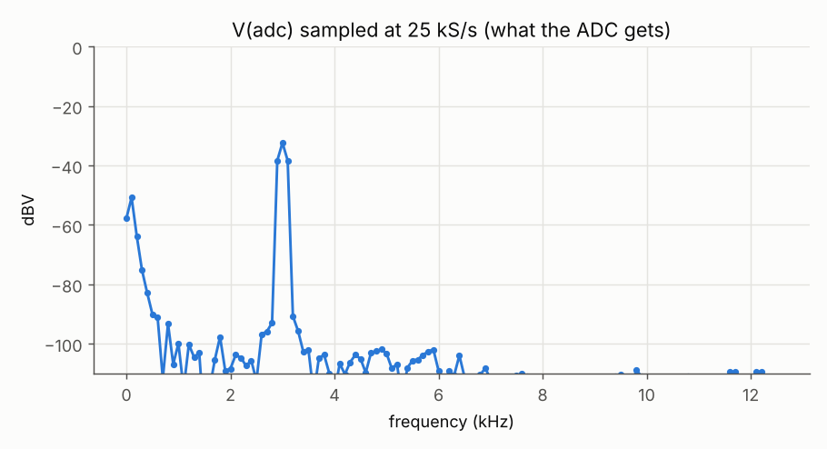
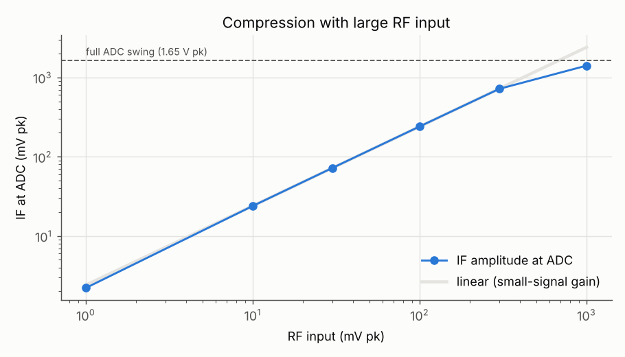
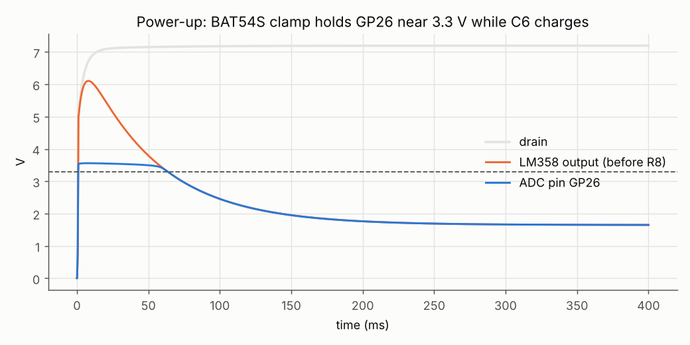

# BF961 mixer with an LM358 Sallen-Key low-pass

This is a second version of the mixer in `../mixer/`. The simple version
stays as it is. The BF961 part (LO on GP8, RF input, self bias, drain load) is
the same in both versions, part for part. The difference is how the IF gets from
the drain to the ADC on GP26:

| | `../mixer/` (simple) | this version |
|---|---|---|
| filter | 1-pole RC, R5 10 kΩ / C5 3.3 nF | 2-pole Sallen-Key with half an LM358, plus a roofing cap at the drain |
| roll-off above the corner | 6 dB per octave | 12 dB per octave |
| -3 dB point | 5.7 kHz | 5.7 kHz |
| filter loss in the passband | 1.9 dB | 0.2 dB |
| at 12.5 kHz (Nyquist) | -9.8 dB | -14.4 dB |
| at 25 kHz | -15.3 dB | -27.5 dB |
| LO (7.1 MHz) at the ADC pin | about 1 mV pp | about 0.02 mV pp |
| extra parts | none | LM358, 4 R, 4 C |

The ADC samples at 25 kS/s, so any signal between 12.5 and 25 kHz from the
LO shows up as a false signal inside the 0 to 12.5 kHz IF band ("aliasing").
A 15 kHz signal, for example, appears at 10 kHz. The Sallen-Key filter is
flat up to about 5 kHz and then falls twice as fast as the RC, so those
aliases come out about 8 to 11 dB weaker (relative to the wanted IF) than with the simple version.



`schematic.png` is generated by `sim/draw_schematic.py` (schemdraw).

## How the new part works

1. **C5 (4.7 nF) on the drain: LO roofing.** The drain carries the kHz IF
   *and* large MHz LO and RF products. The LM358 is a slow op-amp (0.7 MHz
   gain-bandwidth, 0.3 V/µs). At MHz it has no loop gain left, so the
   Sallen-Key filter would leak MHz signals through, and the op-amp could
   rectify them into a DC shift. C5 forms a 34 kHz low-pass with the 1 kΩ
   drain load R4, which takes the 7 MHz LO down by about 46 dB *before* the
   op-amp, while costing only 0.03 dB at 6 kHz. It replaces R5, so the IF
   no longer loses the 1.9 dB that R5 cost in the simple version.
2. **C6 + R6/R7: DC block and 1.65 V bias.** These work the same way as in the simple
   version. The filter input sits at half of 3.3 V. The op-amp is a follower at
   DC, so the ADC pin sits at 1.65 V too, in the middle of its range.
3. **R9, R10, C7, C8, U1A: unity-gain Sallen-Key low-pass (Butterworth).**
   The op-amp is wired as a voltage follower (gain exactly 1). C7 feeds the
   output back to the junction of R9 and R10, and that feedback sharpens the
   corner. The design equations, with Ra = R9 + R4 = 11 kΩ (the drain load
   drives the filter), Rb = R10 = 10 kΩ:

   f0 = 1 / (2π √(Ra·Rb·C7·C8)) = 5.7 kHz  
   Q = √(Ra·Rb·C7·C8) / (C8·(Ra + Rb)) = 0.74 (Butterworth is 0.707)

   To move the corner, scale both capacitors by the same factor. For
   example, C7 = 3.3 nF and C8 = 1.5 nF gives about 6.8 kHz. Keep C7 at
   about twice C8.
4. **R11 (10 kΩ) to GND.** The LM358's output stage has crossover
   distortion when it is unloaded. A steady 165 µA into R11 keeps the
   output stage in class A. The model does not show this effect, so the resistor is there
   for the real board.
5. **R8 + BAT54S: ADC protection.** These are the same as in the simple version. The LM358 runs
   from 9 V, so its output can reach 7.5 V (on overload or at power-up). The
   clamp keeps GP26 below the RP2040's 3.8 V limit.

The LM358 runs from the mixer's 9 V. At that supply its inputs and output
work from 0 V up to 7.5 V, so the 1.65 V bias is well inside the range. The second
half (U1B) is unused: connect pin 5 to GND and pin 6 to pin 7.

## Parts

Only the parts that differ from `../mixer/` are listed here. R1 to R4, C1 to C4, Q1
and D1/D2 are unchanged. R5 is no longer used.

| Ref | Value | Job |
|---|---|---|
| C5 | 4.7 nF | LO roofing at the drain (was 3.3 nF at the RC output) |
| C6 | 1 µF | DC block (film or ceramic) |
| R6, R7 | 100 kΩ | 1.65 V bias from 3V3 |
| R9, R10 | 10 kΩ, 1 % | Sallen-Key resistors |
| C7 | 3.9 nF, C0G/film | Sallen-Key capacitor from the R9/R10 junction to the output |
| C8 | 1.8 nF, C0G/film | Sallen-Key capacitor from the + input to GND |
| U1 | LM358 (DIP-8 or SO-8) | half A = filter op-amp, half B unused |
| R11 | 10 kΩ | output pull-down (class A bias) |
| C9 | 100 nF | LM358 supply decoupling, pin 8 to GND |
| R8 | 1 kΩ | series resistor into GP26 |

LM358 pins: 1 = OUT A, 2 = IN A-, 3 = IN A+, 4 = GND, 5 = IN B+, 6 = IN B-,
7 = OUT B, 8 = V+ (+9 V).

Avoid X7R ceramics for C7 and C8. Their capacitance changes with voltage and
temperature, which would move the filter corner.

## Simulated performance

The full numbers are in `plots/results.txt`. The test conditions are LO 7.1 MHz on GP8 and an
RF tone at 7.103 MHz, 10 mV peak, behind 50 Ω, which gives a 3 kHz IF.

| | This version | Simple RC |
|---|---|---|
| IF at the ADC pin | 24.0 mV pk | 17.9 mV pk |
| conversion gain, RF → ADC pin | +7.6 dB | +5.1 dB |
| gain at 12.5 kHz IF (Nyquist) | -6.3 dB | -1.8 dB |
| gain at 15 kHz IF (aliases to 10 kHz) | -9.6 dB | -3.2 dB |
| gain at 20 kHz IF (aliases to 5 kHz) | -15.1 dB | -5.5 dB |
| ADC pin DC | 1.641 V | 1.643 V |
| 1 V pk RF (huge overload) | 0.004 to 2.90 V at the pin | 0.55 to 2.48 V |
| power-up peak at GP26 | 3.56 V (LM358 output 6.1 V) | 3.48 V |
| supply current | about 3.2 mA (BF961 2.35 mA, LM358 0.7 mA, R11 0.17 mA) | 2.35 mA |








* **IF response:** the points are full mixer transients at each IF. The lines are
  the AC response of each filter, shifted to the same passband gain.
* **Overload:** the mixer stays linear up to about 300 mV of RF. With a huge
  1 V input, the LM358 output reaches its lower limit near 0 V, and the pin stays
  inside 0 to 3.3 V.
* **Power-up:** while C6 charges (about 60 ms), the LM358 output rises to
  6.1 V. The BAT54S holds GP26 at 3.56 V, below the RP2040's 3.8 V
  absolute maximum, and R8 limits the clamp current to about 2.5 mA.

### 5 V supply

The circuit also works with both the mixer and the LM358 on 5 V. As in the simple version, change R3 to
470 Ω. The simulation then gives 1.42 mA, drain at 3.58 V, and a conversion gain
of +6.0 dB (9 V: +7.6 dB). On 5 V the LM358 output can reach only 3.5 V,
which is still enough for the 0 to 3.3 V ADC range, and its inputs work up to
3.5 V, well above the 1.65 V bias.

### About the LM358 model

TI's own SPICE model could not be downloaded here, so `models/lm358.lib` is a
behavioural model built from the datasheet's typical values. `run.py` checks it
first: 100 dB open-loop gain, 0.70 MHz unity-gain frequency, 0.30 V/µs slew
rate, and an output swing from 5 mV to Vcc - 1.5 V. It does not model noise or crossover
distortion. A real LM358 also has up to about 2 to 7 mV of offset. Here that only moves
the 1.65 V level a few mV, and the firmware removes the DC anyway.

## Running the simulation

This needs ngspice and Python 3 with numpy and matplotlib, plus the sibling folder
`../mixer/` for the shared BF961 model. The schematic script also needs
schemdraw.

```
cd mixer_sallenkey
python3 sim/run.py              # all runs, about 5 minutes; writes plots/ and plots/results.txt
python3 sim/draw_schematic.py   # redraws schematic.png
cd sim && ngspice mixer_sk.cir  # quick interactive run with plot windows
```

| File | Contents |
|---|---|
| `models/lm358.lib` | LM358 behavioural model (one amplifier), subckt `LM358 inp inn vcc vee out` |
| `sim/mixer_sk_core.inc` | the circuit, with a detailed comment on every part |
| `sim/mixer_sk.cir` | stand-alone ngspice deck, one 3 ms run at 3 kHz IF |
| `sim/run.py` | model check, filter AC, operating point, mixer runs, IF sweep, overload, power-up, 5 V |
| `sim/draw_schematic.py` | draws `schematic.png` |
| `plots/` | results from the last run |

The optional bandpass filters (`../bandpass/`) and RF preamp (`../rf_preamp/`)
connect to this version the same way as to the simple one: preamp output to RF in.
