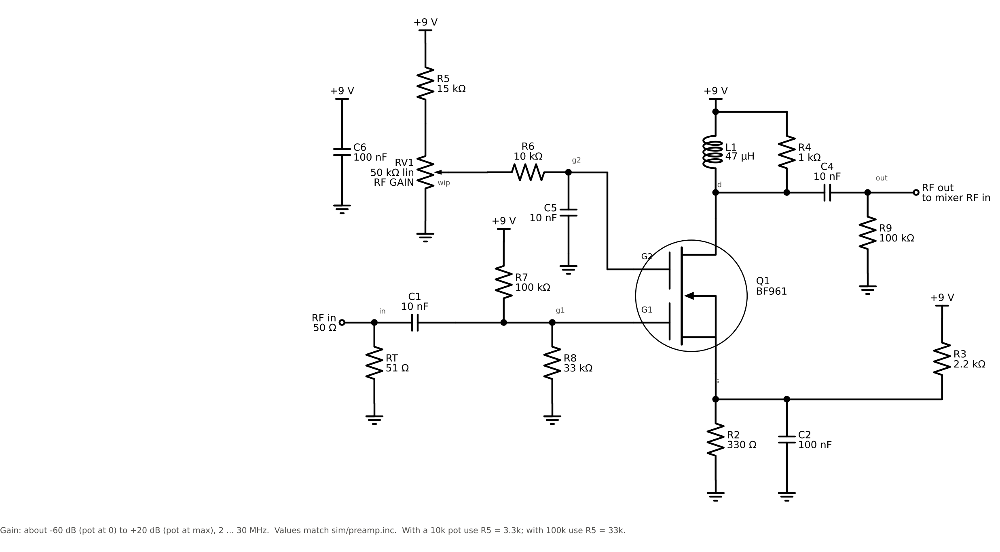
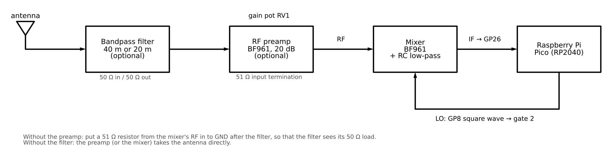
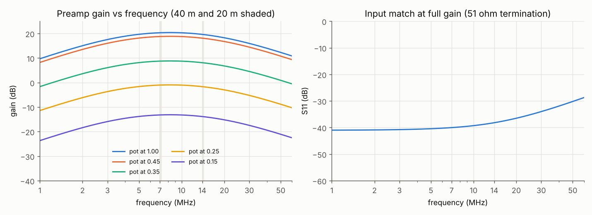
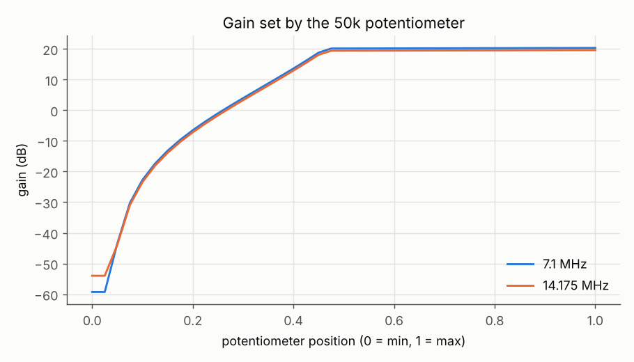
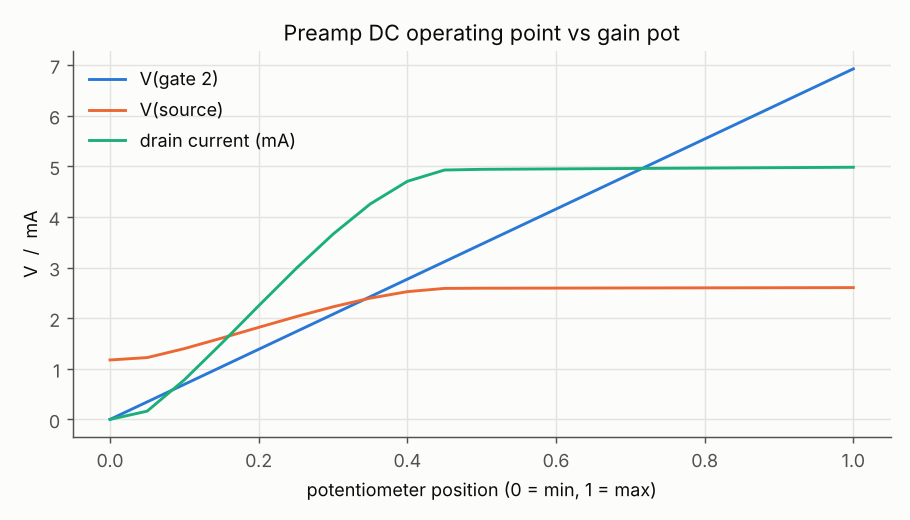
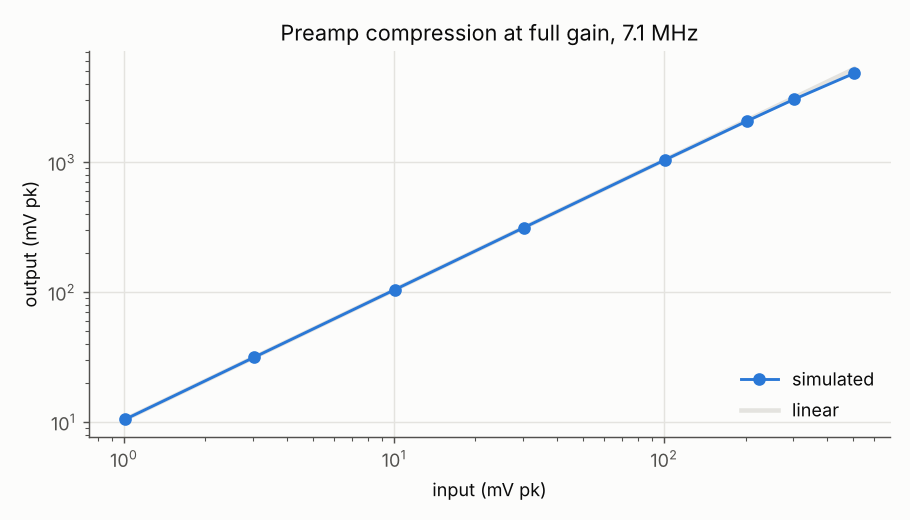
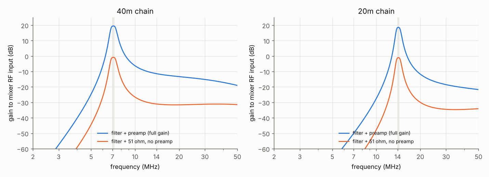

# BF961 RF preamp with gain pot (optional)

This is a broadband RF amplifier (about 2 to 30 MHz) for the front of the
receiver. It uses a second BF961, and a potentiometer sets the gain from
about +20 dB down to about -60 dB (effectively off). It is optional. The
mixer alone needs about 10 mV of RF to produce a usable IF, and the preamp
brings that down by about 18 dB.



## Where it goes



```
antenna ──► [bandpass filter] ──► RF preamp ──► mixer RF in   (mixer/README.md)
                                                 Pico GP8 ──► mixer gate 2 (LO)
                                                 mixer IF ──► Pico GP26 (ADC)
```

The preamp's input is terminated in 51 Ω, so it is the correct load for the
bandpass filters in `../bandpass/`. Its output (RF out) connects straight to
the mixer's RF in (the mixer's C1). It runs from the same 9 V supply as the
mixer.

## How it works

* **Gate 1 (RF):** RT terminates the input in 51 Ω. C1 blocks DC, and R7/R8
  bias gate 1 at +2.2 V.
* **Drain:** the RF choke L1 lets the drain sit at the full 9 V. R4 (1 kΩ)
  is the RF load and sets the gain to about gm × 1 kΩ ≈ 20 dB. R4 also damps
  the choke, which keeps the response flat. C4 passes the RF to the output,
  and R9 gives the output a DC path to ground. Without R9, the wire between
  C4 and the mixer's C1 would float.
* **Gate 2 (gain):** the pot RV1 and R5 form a divider from 9 V, so the
  wiper goes from 0 V to 6.9 V. R6 and C5 feed that voltage to gate 2 and
  keep gate 2 at RF ground, which a dual-gate MOSFET needs in order to work
  as a cascode. Changing the gate-2 voltage changes the transconductance and
  with it the gain. This is how an AGC voltage works in a BF961 amplifier.
* **Source held above ground:** a BF961 switches off only when gate 2 is
  about 1 V *below* the source, and there is no negative supply. The bleeder
  R3 (2.2 kΩ from 9 V) and R2 (330 Ω to ground) therefore hold the source at
  1.17 V even with no drain current. With the pot at 0 V, VG2S is -1.2 V and
  the amplifier is off. At full gain the source sits at 2.6 V. C2 bypasses
  the source for RF.

## Which potentiometer

**Use the 50 kΩ (linear) pot with R5 = 15 kΩ.**

Gate 2 draws no DC current (the datasheet allows 100 nA at most), so all
three values work, and only R5 has to change with the pot:

| Pot RV1 | R5 | Divider current | Notes |
|---|---|---|---|
| 10 kΩ | 3.3 kΩ | 0.68 mA | works; wastes the most current |
| **50 kΩ** | **15 kΩ** | **0.14 mA** | chosen: little current, wiper impedance (≤ 16 kΩ) still low |
| 100 kΩ | 33 kΩ | 0.07 mA | works just as well; R6/C5 then filter a little slower |

50 kΩ is the middle ground. It draws only 0.14 mA, and the wiper impedance
is still low enough that gate leakage and pickup on the pot wiring don't
matter. With any of the three, the top of the range is about 6.8 to 6.9 V at gate 2.
That keeps VG2S below the 8 V minimum breakdown of the gate protection
diodes.

## Parts

| Ref | Value | Job |
|---|---|---|
| Q1 | BF961 | the amplifier |
| RT | 51 Ω | 50 Ω input termination |
| C1 | 10 nF | input DC block |
| R7, R8 | 100 kΩ, 33 kΩ | gate-1 bias, +2.2 V |
| R2 | 330 Ω | source resistor |
| R3 | 2.2 kΩ | bleeder from 9 V; holds the source up so that gate 2 can switch Q1 off |
| C2 | 100 nF | source RF bypass |
| L1 | 47 µH | drain RF choke (small axial choke, ≥ 20 mA) |
| R4 | 1 kΩ | RF load resistor; sets the gain |
| C4 | 10 nF | output DC block |
| R9 | 100 kΩ | output DC return |
| RV1 | 50 kΩ linear | RF GAIN control |
| R5 | 15 kΩ | sets the top of the gate-2 range to 6.9 V |
| R6, C5 | 10 kΩ, 10 nF | feed gate 2 and keep it at RF ground |
| C6 | 100 nF | 9 V decoupling at the preamp |

Current draw is about 8 mA at full gain: 5 mA through the BF961, 2.9 mA
through the bleeder R3 and 0.14 mA through the pot.

## Simulated performance

The BF961 model is the one from `../mixer/models/bf961.lib`. The full numbers
are in `plots/results.txt`. "Gain" is from the 50 Ω input terminal to the
mixer's RF input, loaded by 100 kΩ ∥ 6 pF.

| | Value |
|---|---|
| Gain at full pot | 20.3 dB at 7.1 MHz, 19.6 dB at 14.2 MHz (18.4 dB at 3.6 MHz, 16.3 dB at 28.5 MHz) |
| Gain range | about 80 dB (-59 dB to +20 dB) |
| Input match | S11 better than -34 dB from 1 to 30 MHz |
| Compression | still linear at 0.3 V pk in / 3 V pk out (gain down 0.2 dB); far more than the mixer can take |






**About the pot's feel:** in the simulation, all the gain change happens in
the first half of the pot's rotation, and the gain is flat above about 0.5.
That comes from the model: its gate-2 section is fitted only to the
datasheet's cut-off voltage, and it reaches full gain at VG2S ≈ 1 V. A real
BF961 keeps gaining up to VG2S ≈ 4 V (datasheet Fig. 3), so a real build
should spread the gain change over more of the rotation. That is why the
top of the range is 6.9 V and not lower. If you want a more even feel,
swap the linear pot for a log (audio) pot.

## The whole chain

`run.py` also simulates the full front end. An antenna signal of 1 mV peak
(EMF, behind 50 Ω) at 7.103 MHz goes through the 40 m filter and the preamp,
then into the complete mixer with the 7.1 MHz LO. The 3 kHz IF is measured at
the ADC pin.

| Build | IF at GP26 | vs. mixer alone |
|---|---|---|
| A: mixer alone (antenna into the mixer's RF in) | 1.94 mV pk | 0 dB |
| B: 40 m filter + 51 Ω → mixer | 1.01 mV pk | -5.7 dB |
| C: 40 m filter → preamp (full gain) → mixer | 8.27 mV pk | **+12.6 dB** |
| D: 40 m filter → preamp (pot at 0.30) → mixer | 1.22 mV pk | -4.0 dB |

Build C is about 18 dB above B, which is the setup with the same filter but
no preamp. Compared with A, the gain is partly used up because a terminated
50 Ω input sees only half the EMF, while the mixer alone sees the whole open
voltage.



The chain AC plot shows the filter and preamp response up to the mixer
input. With the preamp at full gain, the 3 × f_LO response is still about
33 dB below the wanted band (on 40 m: +19.5 dB at 7.1 MHz, -13.6 dB at
21.3 MHz).

## Running the simulation

This needs ngspice and Python 3 with numpy and matplotlib, plus the sibling
folders `../mixer/` and `../bandpass/`. The schematic script also needs
schemdraw.

```
cd rf_preamp
python3 sim/run.py              # all runs, about 1 minute; writes plots/ and plots/results.txt
python3 sim/draw_schematic.py   # redraws schematic.png and chain.png
cd sim && ngspice preamp.cir    # quick interactive run with a plot window
```

| File | Contents |
|---|---|
| `sim/preamp.inc` | preamp subcircuit `PREAMP` (pins: in, out, vdd; parameters pos, rpot, rtop) |
| `sim/preamp.cir` | stand-alone ngspice deck, one operating point + AC sweep |
| `sim/run.py` | DC, AC, pot sweep, compression, chain AC and chain transient, plots |
| `sim/draw_schematic.py` | draws `schematic.png` and `chain.png` |
| `plots/` | results from the last run |
